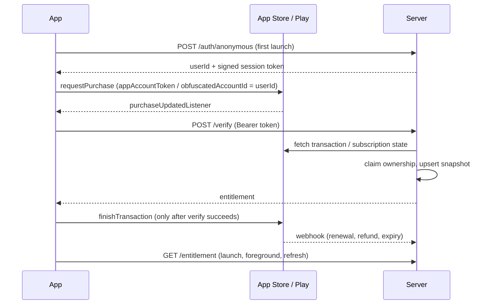

# Flamingo Paywall Demo

Expo subscription paywall with `expo-iap` and a Node verification server that owns the entitlement.

```
app/     Expo app: paywall, IAP layer, session, entitlement cache, premium gate
server/  Express: /auth/anonymous, /verify, /entitlement, App Store + Play webhooks
```

## Versions

| Piece | Version |
|---|---|
| Expo SDK | 58 (New Architecture) |
| React Native | 0.88 |
| `expo-iap` | 6.1.0 (peer deps `expo: *`, `react-native: *`) |
| Server | Node 22.13+ (`node:sqlite`, `--env-file-if-exists`), Express 5 |

Real purchases need a development build. The `expo-iap` native module does not run in Expo Go.

## Architecture



## Subscription correctness and reliability

**The server is the source of truth.** Access is decided by the server's `subscriptions` table. The app
keeps a copy in secure storage only as a cache for fast startup and short offline periods.

- **Account association.** On first launch the app calls `POST /auth/anonymous` and gets a server-issued
  `userId` and HMAC-SHA256 session token. Every other call sends `Authorization: Bearer <token>`, and the
  server takes the user from the token. A `userId` in a request body is ignored. The same `userId` is passed
  to the store as `appAccountToken` (iOS) / `obfuscatedAccountId` (Android), and the server rejects a purchase
  whose store account id doesn't match the caller (403). In Flamingo this would be the real signed-in account.
- **Verify before finish.** The app calls `finishTransaction` only after `/verify` succeeds. If verification
  fails or the app is killed, the transaction stays unfinished and the store redelivers it on next launch,
  so a user is never charged without being unlocked.
- **Pending purchases are never granted.** The client shows "waiting for approval" for pending purchases and
  doesn't send them to `/verify`. On the server, Play's `SUBSCRIPTION_STATE_PENDING` is not an entitled state.
  Android purchases are acknowledged only when the subscription is active.
- **Safe retries.** `/verify` is keyed by the store's own id (`originalTransactionId` / `purchaseToken`) and
  writes a full snapshot, so repeating it changes nothing. The client retries up to 3 times with exponential
  backoff and full jitter, only on network errors and 5xx (never on 4xx). If acknowledging a Play purchase
  fails, the server re-fetches and treats "already acknowledged" as success.
- **Atomic ownership claim.** The upsert is a single conditional statement
  (`ON CONFLICT DO UPDATE ... WHERE user_id = excluded.user_id`), so when two accounts verify the same receipt
  at the same time exactly one wins and the other gets 403. One-time side effects (the `purchase_success`
  server event) run only when the row was actually created, never on replays.
- **Webhooks are authenticated.** Apple payloads are verified with `SignedDataVerifier` (JWS chain to Apple's
  root). Play Pub/Sub pushes must carry a Google-signed OIDC token for `GOOGLE_PUBSUB_AUDIENCE` from
  `GOOGLE_PUBSUB_SERVICE_ACCOUNT`. Play notifications are only a trigger: the server re-fetches the real state
  from `subscriptionsv2.get`. Invalid signatures return 401.
- **Webhooks are idempotent and ordered.** Each notification id (Apple `notificationUUID`, Pub/Sub `messageId`)
  is inserted into a `processed_events` ledger in the **same transaction** as the state change. A duplicate
  returns 200 and changes nothing. A crash rolls back both, so the store's retry is processed. Each snapshot
  carries a `source_ts` (Apple `signedDate`, Play fetch time) and is applied only if it is at least as new as
  the stored one, so out-of-order deliveries can't resurrect old state. The server returns 200 only after
  commit and 5xx on failure, so Apple (retries at 1, 12, 24, 48, 72h) and Pub/Sub redeliver. Ledger rows are
  pruned after 30 days.
- **Offline cap.** Cached access is honored until `min(expiresAt, lastVerifiedAt + 72h)`. The cache is
  replaced from `GET /entitlement` on launch, on foreground, and on "Refresh from server". If the server is
  unreachable, the home screen says so and shows when access was last verified.

## Run the demo without store accounts (mock mode)

```bash
cd server && cp .env.example .env && npm install && npm start      # IAP_MOCK=1, port 4000
cd app && npm install && npm run mock -- --web                      # or press i / a for a simulator
```

Mock mode does **not** verify anything with Apple or Google. It proves the app flow, the server's
idempotency/ownership/ordering logic, and the entitlement cache. It does not prove that real receipts,
signatures, or store notifications are handled correctly.

On the paywall, the "Mock store outcome" chips simulate success, user cancel, pending (Ask to Buy, approved
after 4s), and store errors. Simulate store notifications with the mock-only route (enabled only when
`IAP_MOCK=1`, with a startup warning):

```bash
curl -XPOST localhost:4000/mock/webhook -H 'Content-Type: application/json' \
  -d '{"eventId":"evt-1","userId":"<user id from home screen>","event":"refund"}'
```

`event` is `refund`, `expire`, or `renew`. Send the same `eventId` again and the response has
`"duplicate": true`. Then tap "Refresh from server" (or background/foreground the app) and premium locks.

## Debug logs

The server logs every decision (`[auth]`, `[verify]`, `[db]` upsert created/updated/stale/rejected, `[ledger]`
applied/duplicate/rolled back, `[apple]`, `[google]`, `[mock]`, `[http]`). Level comes from `LOG_LEVEL`
(`debug` by default in mock mode, `info` otherwise; tests are `silent` unless you set it). The app logs
`[session]`, `[http]`, `[retry]`, `[iap]`, `[sync]`, `[restore]`, `[cache]` in dev builds, or in release with
`EXPO_PUBLIC_DEBUG_LOGS=1`. User ids are shortened to 8 chars so a line in the app log matches the server log.

## Tests

```bash
cd server && npm test      # 13 tests: node:test + fetch against the app on an ephemeral port
cd app && npm test         # 8 tests: offline cap, trial parsing, savings
```

## Test status

**Automated (server, mock mode):**
- verify unlocks; unknown product is rejected (400)
- no session or a tampered token gets 401; a `userId` in the body is ignored
- repeating verify leaves one row and fires the first-grant side effect once
- 10 parallel verifies of the same purchase leave one row
- two users verifying the same receipt concurrently: one 200, one 403
- refund and expiry notifications lock access
- a duplicate notification id is processed once, even if the replay carries a newer timestamp
- an older out-of-order snapshot does not overwrite a newer one
- a crash mid-processing rolls back the ledger row, and the retry is applied
- a fresh client (relaunch) reads access from the server

**Automated (app):** the 72h offline cap, Android trial offer selection, iOS trial eligibility, yearly savings.

**Manually tested in mock mode (web):** purchase success unlocks premium (with the session-token flow);
pending (Ask to Buy) shows "waiting" and unlocks only after approval; refund relocks after refresh; with the
server stopped, cached access stays and the offline notice appears.

**Not yet tested against real stores:** App Store sandbox and Play license-tester purchases, Apple JWS
verification, App Store Server Notifications V2, Play RTDN via Pub/Sub with OIDC, and Play acknowledgement.
These need App Store Connect / Play Console products, API credentials, sandbox testers, and a dev build.

## Run against real stores

1. Create `flamingo_premium_monthly` and `flamingo_premium_yearly` (with a free-trial intro offer / Play offer)
   in App Store Connect (same subscription group) and Play Console.
2. Fill in `server/.env` with `IAP_MOCK=0`, a strong `SESSION_SECRET`, and the Apple/Google/Pub/Sub values
   listed in `.env.example`.
3. Build a development client:

```bash
cd app
EXPO_PUBLIC_API_URL=http://<your-lan-ip>:4000 npx expo run:ios --device   # or run:android
# or: npx eas-cli@latest build --profile development
```

4. Point App Store Server Notifications V2 at `/webhooks/apple` and Play RTDN (Pub/Sub push with
   authentication enabled) at `/webhooks/google`.

## Manual test checklist (real stores)

- [ ] Buy monthly and yearly in sandbox; premium unlocks and the server row has the right expiry
- [ ] Kill the app between purchase and verify; on relaunch the purchase is redelivered and unlocks
- [ ] Ask to Buy / Play pending payment: stays locked until approved
- [ ] Restore on a fresh install / second device with the same store account
- [ ] Refund in sandbox; the webhook arrives and premium locks after refresh
- [ ] Let a sandbox subscription expire; access ends
- [ ] Replay a webhook (resend from App Store Connect); no state change
- [ ] Android: purchase is acknowledged (no auto-refund after 3 days)
- [ ] Airplane mode: cached access works, offline notice shows, access ends after 72h unverified

See `INTERVIEW_PREP.md` for the design walkthrough and talking points.
